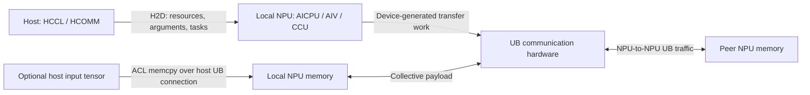

# 11 — HCCL/HCOMM collective communication: host–device traffic over UB

[Summary](README.md) · Previous: [Batch correctness review](10_batch_correctness_review.md)

Analysis date: 2026-10-10. Source snapshots: `hccl` at `e6c81224`,
`hcomm` at `f9f91c084`, `runtime` at `216912472`, and `driver` at `866e409`.
The HCCL/HCOMM worktrees were clean when inspected. These independently
checked-out versions have not been validated as an installed software stack.
This is a source analysis; no collective workloads or hardware measurements
were run.

## 1. What counts as H2D traffic

For a normal device-buffer collective, H2D traffic consists mainly of
communication setup, resource descriptions, kernel arguments, instructions,
and task submission. The collective's tensor payload moves between NPU
buffers. A host call to `HcclAllReduce` does not imply that the tensor is
uploaded from host RAM on every call.

The repository's [AllReduce example](../../hccl/examples/02_collectives/01_allreduce/main.cc#L45)
makes the distinction concrete:

```text
aclrtMalloc(sendBuf / recvBuf)                  allocate device buffers
aclrtMallocHost(hostBuf)                       allocate host input
aclrtMemcpy(sendBuf, hostBuf, HOST_TO_DEVICE)   application H2D payload
HcclCommInitRootInfo(...)                      communicator setup
HcclAllReduce(sendBuf, recvBuf, ..., stream)    collective on device buffers
aclrtSynchronizeStream(stream)                 wait for collective completion
aclrtMemcpy(resultBuf, recvBuf, DEVICE_TO_HOST) optional application D2H result
```

If a preceding NPU kernel produces the input tensor, that application H2D
copy is unnecessary. Likewise, downstream NPU computation can consume the
result without a D2H copy. The official
[HCCL introduction](https://www.hiascend.com/document/detail/zh/CANNCommunityEdition/83RC1alpha003/hccl/hcclug/hcclug_000003.html)
also separates input upload from the collective call; it is background for
this distinction, not evidence for the current 950 implementation.

Two connections must be distinguished:

- **Host ↔ local NPU:** selects how context, arguments, and SQEs reach the
  local device. This chapter assumes the UB host connection used in 01–10.
- **NPU ↔ peer NPU:** selects the collective channel and payload transport.
  The detailed AICPU example below uses the UB channel. A UB peer channel
  alone does not establish that the host connection also uses UB.



## 2. Application content → API → UB mechanism

“First use” includes lazy initialization and creating a new algorithm/resource
cache entry. It is not a guarantee that every allocation occurs during
`HcclCommInitRootInfo`.

| Application content | HCCL/HCOMM and runtime/driver API | UB interface used | Description / frequency |
|---|---|---|---|
| Host-resident input tensor before a collective | Application `aclrtMemcpy` / `aclrtMemcpyAsync` | Sync **URMA — host WRITE**; eligible async **device READ** after runtime work preparation | Optional bulk H2D. Uses the previously traced runtime copy path, separate from the collective algorithm. Pageable async fallback can select sync WRITE. |
| Serialized AICPU algorithm context | `HcclMemcpyCtxHostToDevice` → `HcclEngineCtxCopy` → `HcommEngineCtxCopy` → `hrtMemSyncCopy` → `aclrtMemcpy(H2D)` | **URMA — host WRITE**, through runtime/HAL | Topology, resource handles, algorithm hierarchy, and other serialized context. Copied when resources are created/rebuilt; reusable contexts can avoid this upload. |
| Channel resources and initialization parameters | `AicpuTsUrmaChannel::H2DResPack`; `ChannelProcess::LaunchChannelKernelCommon` → `hrtMemSyncCopy` and an initialization kernel | **URMA — host WRITE** for serialized resources; runtime argument/SQ submission for the init kernel | Local/remote memory and notify metadata, connection information, size arrays, and initialization descriptors. These describe buffers; they do not upload the buffers' tensor contents. |
| AICPU collective launch arguments | `AicpuKernelLaunch` → `aclrtKernelArgsAppend` / `aclrtLaunchKernelWithConfig` → runtime argument loader | Ordinary stream: **URMA — host argument WRITE**, then task/tail WRITE | `sizeof(OpParam) + varMemSize` is appended at HCCL's API boundary. It includes input/output addresses and operation metadata. Runtime framing/alignment adds overhead. |
| AIV peer-buffer tables and channel entities | `HcclAllocAlgResourceAiv` → `haclrtMemcpy(H2D)`; `AivUrmaChannel` entity copies → `HrtMemcpy` | **URMA — host WRITE**, through synchronous runtime copies | Remote buffer/flag addresses and, for network channels, registered buffer/notify/connection metadata. Setup/update traffic; not the peer tensor payload. |
| AIV collective launch arguments | AIV `ExecuteKernelLaunchInner` → `aclrtLaunchKernelWithHostArgs` | Ordinary stream: **URMA — host argument WRITE**, then task/tail WRITE | Vector kernel parameters; AIV executes the selected communication algorithm on device. |
| Compiled CCU instructions | `CcuKernelMgr::LoadInstruction` → `hrtMemcpy(H2D)` | **URMA — host WRITE** to device staging memory | Copies `instruction_count × sizeof(CcuInstr)` bytes. Instruction installation is a separate control request in the next row. Reusable kernels avoid recompiling/reinstalling on every launch. |
| CCU resource/configuration and instruction-install requests | `HccpRaTlvCcuCustomChannel` → `RaTlvRequest` → HDC → `halHdcSend` / receive | **HDC over URMA — SEND/RECV** on the selected UB HDC path | TLV service messages, e.g. `CCU_U_OP_SET_INSTRUCTION`, carry a device staging address, length, and instruction offset. They are control messages, not the collective tensor payload. |
| CCU launch parameters and scheduling | `HcommCcuKernelLaunch` → `rtCCULaunch` → `StreamCCULaunch` → `DavidSendTask` | **URMA — host SQ/tail WRITE** in the ordinary UB submission path | The standalone runtime path packs launch arguments into two SQEs. This is separate from instruction installation. |
| Stream dependencies and task submission | Runtime notify/wait tasks and `halSqTaskSend` | **URMA — host SQ/tail WRITE** | Orders communication against compute and other streams. SQEs are control traffic, not copies of tensors referenced by those SQEs. |
| Collective tensor exchange and reduction | AICPU HCOMM READ/WRITE/reduce primitives; AIV or CCU equivalents | **Device-initiated UB data movement**, including READ/WRITE and supported reduction/notify operations; selected AIV paths can use mapped-memory access | Normally **D2D**, rather than H2D. The exact mechanism depends on the selected engine, channel protocol, and algorithm. |
| Completion and optional host results | HCOMM stream notifications, runtime stream synchronization; application `aclrtMemcpy(D2H)` | Runtime task-report path for completion; **URMA — host READ** for ordinary sync D2H payload | Communication completion, task completion, and copying result bytes into host RAM are separate events. |

The foundation for the runtime/HAL mappings is in
[02: memcpy](02_sync_and_async_memcpy.md),
[03: arguments and SQ submission](03_trs_task_and_args_submission.md),
[04: HDC](04_queue_and_hdc.md), and
[06: ACL/runtime dispatch](06_acl_runtime_dispatch.md).
Sections below provide the new HCCL/HCOMM callers and their source evidence.

## 3. Entry point and engine selection

The inspected `HcclAllReduce` first checks the HCOMM version and whether the
device uses the newer operator implementation. `IsOutPlaceDevice` identifies
devices at or above 950; the helper's name here should not be interpreted as
a host/device memory-copy decision. Older versions/devices route to the
compatibility implementation.

```text
HcclAllReduce
  → AllReduceOutPlace / AllReduceOutPlaceCommon
      → fill OpParam with input/output pointers, count, datatype, reduction
      → HcclGetOpExpansionMode
      → algorithm selection / optional cached fast path
      → HcclExecOp
          → HcclGetAlgRes
          → AICPU, AIV, or CCU execution branch
```

See [entry/compatibility dispatch](../../hccl/src/ops/all_reduce/all_reduce.cc#L23),
[device predicate](../../hccl/src/common/hccl_common.h#L348),
[engine/algorithm selection](../../hccl/src/ops/all_reduce/all_reduce.cc#L189),
and [execution branches](../../hccl/src/ops/op_common/op_common.cc#L812).
Communicator configuration and available resources can change the selected
engine; CCU resource failure can trigger algorithm fallback. The word “UB”
does not select one universal execution engine.

HCCL owns the collective algorithms; HCOMM provides communicator/resource
management and communication primitives. Calls across the repositories are
dynamically resolved. Some active implementations are still in HCOMM's
`legacy/ascend950` directory: the path name alone does not mean they are
inactive. See the [local architecture description](../../hcomm/docs/zh/architecture/architecture-brief.md).

## 4. AICPU: upload resources, launch once, generate communication work on device

### 4.1 Algorithm context is a real H2D transfer

```text
GetAlgResAICPU
  → allocate algorithm resources
  → AlgResourceCtxSerializable::Serialize()
  → HcclMemcpyCtxHostToDevice
      → HcclEngineCtxCreate(..., COMM_ENGINE_AICPU_TS, ...)
      → HcclEngineCtxCopy
          → EngineCtxs::CopyCommEngineCtx
          → HcommEngineCtxCopy
              → hrtMemSyncCopy(HOST_TO_DEVICE)
              → aclrtMemcpy
              → runtime/HAL UB synchronous copy → host WRITE
```

The serialized resource blob is not the tensor data referred to by its
addresses. The caller attaches the resulting device context pointer to
`OpParam.resCtx`. Resource reuse is checked before allocation and copying.

Evidence: [serialize and upload](../../hccl/src/ops/op_common/op_common.cc#L1700),
[context-copy entry](../../hccl/src/ops/op_common/op_common.cc#L1738),
[HCOMM context copy](../../hcomm/src/base_comm/primitives/api_c_adpt/hcomm_engine_ctx_c_adpt.cc#L55),
[ACL adapter](../../hcomm/src/legacy/ascend910/platform/common/adapter/adapter_rts.cc#L805),
and [reuse predicate](../../hccl/src/ops/op_common/op_common.cc#L1354).

Context names alone do not establish H2D: `HcommEngineCtxCreate/Copy` uses
ordinary host allocation/copy for CPU, CPU_TS, and CCU contexts, and device
allocation/H2D copy for AICPU, AICPU_TS, and AIV. A CCU host-side cached context
must not be counted as an instruction upload.

### 4.2 UB channel resources are also copied to the device

`AicpuTsUrmaChannel::BuildConnection` creates a device-used UB connection,
including UB_CTP or UB_TP selection and `STARS_POLL` completion mode.
`H2DResPack` serializes its transport description. `UbMemTransport::GetUniqueIdV2`
includes local/remote buffer, notify, drain, and connection descriptions.
Despite the name `UbMemTransport`, this selected AICPU path ultimately builds
Jetty work; the class name does not imply direct CPU load/store access.

`ChannelProcess::LaunchChannelKernelCommon` copies the packed resource bytes
and size vector to device memory, then launches an initialization kernel.
Its kernel-parameter helper also copies the initialization structure and
waits for initialization completion. Resource export/init can therefore
produce both memcpy traffic and task/argument traffic.

Evidence: [device-used UB connection](../../hcomm/src/base_comm/resources/endpoint_pairs/channels/aicpu/aicpu_ts_urma_channel.cc#L99),
[resource packing](../../hcomm/src/base_comm/resources/endpoint_pairs/channels/aicpu/aicpu_ts_urma_channel.cc#L322),
[transport serialization](../../hcomm/src/legacy/ascend950/unified_platform/resource/transport/ub_mem_transport.cc#L981),
[resource upload](../../hcomm/src/base_comm/resources/endpoint_pairs/channels/channel_process.cc#L679),
and [initialization kernel](../../hcomm/src/base_comm/resources/endpoint_pairs/channels/channel_process.cc#L565).

### 4.3 Per-call arguments use runtime's UB argument path

```text
HcclAicpuKernelEntranceLaunch
  → AicpuKernelLaunch
      → aclrtKernelArgsAppend(&param, sizeof(OpParam) + param.varMemSize)
      → aclrtLaunchKernelWithConfig("HcclLaunchAicpuKernel", ...)
          → ApiImplDavid::LaunchKernelByHandle [CPU kernel branch]
          → CpuKernelLaunchExAll
          → StreamLaunchCpuKernelExWithArgs
              → LoadArgsInfo → StarsArgManager
              → UbArgManage::H2DArgCopy
                  → host staging copy
                  → SqArgsCopyWithUb → halSqTaskArgsAsyncCopy
              → DavidSendTask → halSqTaskSend
```

This extends chapter 06's non-CPU launch example with an explicitly traced
AICPU caller. On an ordinary UB stream, argument WRITEs are ordered before
the task/tail WRITEs. For software-SQ/capture or auto-split streams,
`UbArgManage::ParseArgsCpyWqe` selects synchronous H2D copying instead.
Argument-copy and graph-replay behavior must therefore be classified by
stream mode.

Evidence: [HCCL launch](../../hccl/src/ops/op_common/op_common.cc#L1168),
[runtime CPU dispatch](../../runtime/src/runtime/api/impl/api_impl_david.cc#L177),
[AICPU task construction](../../runtime/src/runtime/core/src/launch/aicpu_starsv2.cc#L330),
[CPU argument overload](../../runtime/src/runtime/core/src/kernel/arg_loader/stars_arg_manager.cc#L187),
and [UB copy selector](../../runtime/src/runtime/core/src/kernel/arg_loader/arg_manage_ub.cc#L82).

`OpParam` contains addresses and operation metadata. Variable-length
collectives can add rank-dependent metadata: the inspected AllGatherV path
allocates `2 × rank_count × sizeof(u64)` bytes for its variable argument
area. Thus control traffic is not universally a tiny fixed-size constant.
See [AllGatherV argument allocation](../../hccl/src/ops/all_gather_v/all_gather_v.cc#L211).

### 4.4 Communication WQEs are produced by AICPU

After launch, `HcclLaunchAicpuKernel` runs the executor on the device, or
replays an AICPU task-cache entry. Algorithm transfer wrappers call HCOMM
primitives. For the selected A5 UB channel:

```text
Device AICPU: collective executor
  → HcommReadOnThread / HcommWriteOnThread / batch/reduction variants
  → UbTransportLiteImpl
      → UbConnLite constructs READ/WRITE WQEs in the device-used Jetty SQ
      → BuildUbDbSendTask
          → RtsqA5::UbDbSend
          → local STARS task submission
  → STARS executes the UB doorbell task
  → UB hardware moves/reduces data between NPU memory regions
```

`UbConnLite::LaunchOneWqe` writes the WQE to the SQ address and advances its
producer index. `RtsqA5::LaunchTask` copies generated SQEs into its RTSQ and
updates the tail. These operations execute on the device in this branch;
they are not another host-to-device upload for every tensor chunk.

Evidence: [device executor/cache](../../hccl/src/ops/op_common/algorithm/template/aicpu/kernel_launch.cc#L653),
[algorithm transfer wrapper](../../hccl/src/ops/op_common/algorithm/template/wrapper/alg_data_trans_wrapper.cc#L388),
[HCOMM A5 WRITE dispatch](../../hcomm/src/base_comm/primitives/api_c_adpt/aicpu_ts_primitives_c_adpt.cc#L433),
[batch dispatch](../../hcomm/src/base_comm/primitives/api_c_adpt/aicpu_ts_primitives_c_adpt.cc#L847),
[UB READ and doorbell task](../../hcomm/src/legacy/ascend950/unified_platform/resource/transport/aicpu/ub_transport_lite_impl.cc#L626),
[WQE write](../../hcomm/src/legacy/ascend950/unified_platform/resource/connection/aicpu/ub_conn_lite.cc#L253),
and [device RTSQ submission](../../hcomm/src/legacy/ascend950/unified_platform/resource/stream/aicpu/rtsq_a5.cc#L225).

## 5. CCU: instruction installation and launch are separate

CCU is the Collective Communication Unit. Its instruction setup has two
explicit transfers:

```text
Host compiles/translates CCU kernel
  → CcuKernelMgr::LoadInstruction
      1. hrtMemcpy(H2D): instruction vector → device staging memory
      2. HccpRaTlvCcuCustomChannel(CCU_U_OP_SET_INSTRUCTION)
           includes staging address, length, die, and instruction offset
           → RaTlvRequest → RaHdcTlvRequest → RaHdcProcessMsg
           → halHdcSend / halHdcRecv
```

The manager explicitly creates this TLV connection in HDC mode. HCOMM's
device-side service dispatches the request to `RsCcuCustomChannel`, which
resolves the external `ccu_custom_channel` implementation. The final internal
copy into CCU instruction storage is outside the inspected implementation;
the host upload and service request are directly visible.

Evidence: [instruction staging and install request](../../hcomm/src/base_comm/resources/ccu/ccu_kernel/ccu_kernel_mgr.cc#L855),
[TLV wrapper](../../hcomm/src/base_comm/resources/southbound_adpt/hcomm_adapter_hccp.cc#L503),
[HDC mode](../../hcomm/src/legacy/ascend950/unified_platform/common/hccp_tlv_hdc_manager.cc#L33),
[TLV framing](../../hcomm/src/base_comm/resources/hccp/rdma_agent/hdc/ra_hdc_tlv.c#L124),
[HDC send binding](../../hcomm/src/base_comm/resources/hccp/rdma_agent/hdc/ra_hdc.c#L31),
and [device service dispatch](../../hcomm/src/base_comm/resources/hccp/rdma_service/tlv/rs_tlv.c#L153).
The selected driver UB HDC payload opcode is
[`URMA_OPC_SEND`](../../driver/src/ascend_hal/hdc/ub/common/hdc_ub_drv.c#L2149).

Launch of the installed kernel follows a different path:

```text
HCCL CCU template
  → HcommCcuKernelLaunch
      → generate task parameters
      → LaunchCcuTasks → rtCCULaunch
          → StreamCCULaunch → DavidSendTask
          → ordinary UB SQ/tail WRITEs
  → STARS schedules CCU
  → CCU executes the installed instruction sequence
  → device-to-device UB payload operations
```

`LaunchCcuTasks` passes die/mission IDs, instruction start/count, key,
timeout, and arguments to runtime. `ConstructDavidSqeForCcuLaunchTask`
packs the standalone launch into two SQEs, including argument words.
Do not count the entire CCU instruction vector as H2D bytes for every
cached-kernel launch.

Evidence: [HCCL CCU launch example](../../hccl/src/ops/all_reduce/algorithm/template/ccu/ccu_temp_all_reduce_mesh_1D_mem2mem.cc#L169),
[HCOMM launch](../../hcomm/src/base_comm/primitives/api_c_adpt/ccu/ccu_launch.cc#L269),
[runtime task submission](../../runtime/src/runtime/feature/ccu/ccu_stream.cc#L18),
[two-SQE construction](../../runtime/src/runtime/feature/ccu/ccu_sqe.cc#L20),
and [collective WRITE/reduction example](../../hccl/src/ops/all_reduce/algorithm/template/ccu/kernel/ccu_kernel_all_reduce_nhr1d_mem2mem.cc#L115).
CCU scheduling and memory-to-memory modes have different internals; this
trace does not identify every CCU instruction with one fixed Jetty opcode.

## 6. AIV: resource tables plus a vector-kernel launch

`HcclAllocAlgResourceAiv` collects peer buffer and flag addresses and copies
the address arrays into device memory. The network-channel implementation
also builds a device channel entity containing local/remote registered
buffers, notifies, and connection metadata. Its array copies call `HrtMemcpy`.
The addresses copied into these structures refer to payload buffers; copying
an address does not copy the referenced tensor.

The algorithm eventually launches its vector kernel through
`ExecuteKernelLaunchInner → aclrtLaunchKernelWithHostArgs`, connecting to
the non-CPU argument/SQ path in chapter 06.

Evidence: [peer-address table upload](../../hccl/src/ops/op_common/op_common.cc#L3304),
[channel entity upload](../../hcomm/src/base_comm/resources/endpoint_pairs/channels/aiv/aiv_urma_channel.cc#L120),
and [vector-kernel launch](../../hccl/src/ops/op_common/algorithm/template/aiv/hccl_aiv_utils.cc#L1141).

AIV does not imply one transport. The inspected channel factory selects
`AivUrmaChannel` for supported UB_CTP/UBC_TP/UB_RTP cases and a separate
`AivUbMemChannel` branch for other applicable memory-access paths. Protocol
and platform support must be checked before calling all AIV payload access
“Jetty WRITE.” This chapter traces their host resource/launch traffic, not
every vector instruction in every AIV collective.
See [channel selection](../../hcomm/src/base_comm/resources/endpoint_pairs/channels/channel.cc#L100).

## 7. Cold setup, steady execution, and completion

| Phase | Expected host–device traffic in the selected paths |
|---|---|
| Communicator/resource setup or first algorithm use | Device allocation/registration and service requests; exported thread/channel resources; serialized algorithm context; initialization kernels; optional binary loading; CCU instruction installation if CCU is selected |
| Reused AICPU execution | Updated launch arguments and runtime task/dependency submission; cached device context reused where permitted; device generates or replays communication work |
| Reused CCU execution | Task parameters/SQEs for installed kernels; reuse can avoid instruction reinstallation |
| Reused AIV execution | Kernel argument/task submission or the selected cache/replay mechanism; existing resource tables reused unless updates are required |
| Tensor initially in host RAM | Additional bulk H2D copy before the collective |
| Result needed by host CPU | Additional D2H payload copy after the required stream dependency/completion |
| New topology, channels, algorithm, or graph/resource lifecycle | Can reintroduce resource copies and initialization; steady-state assumptions must be revisited |

The source has several different caches: resource-context reuse, AICPU
task caching, AIV cache/replay, CCU fast launch, and runtime graph capture.
These should not be treated as one cache or as proof of zero H2D traffic.
For example, [TryReuseResource](../../hccl/src/ops/op_common/op_common.cc#L1354)
rejects ordinary non-OPBASE reuse for non-CCU engines, while AICPU device
task-cache execution has its own path inside the launched kernel.

There are also several different completion boundaries:

1. Successful context memcpy establishes the copied resource bytes are ready.
2. Successful host SQ transport submission publishes work to the device.
3. Device UB transfer completion/notify establishes the algorithm's required
   communication ordering.
4. Runtime stream completion establishes completion of the scheduled work
   covered by the stream dependencies.
5. A later D2H payload copy makes result bytes available in the host buffer.

HCCL's AICPU path places host/device thread notify dependencies around its
launch, and device code records the corresponding completion-side notify.
The public example explicitly synchronizes the stream after `HcclAllReduce`.
An HDC reply acknowledging CCU installation, a Jetty CQ completion, and
completion of the entire collective have different meanings.
See [host ordering](../../hccl/src/ops/op_common/op_common.cc#L1129),
[device notification](../../hccl/src/ops/op_common/algorithm/template/aicpu/kernel_launch.cc#L811),
and [example synchronization](../../hccl/examples/02_collectives/01_allreduce/main.cc#L82).

For traffic accounting, separate:

```text
H2D bytes = optional application input upload
          + resource / instruction uploads when created or updated
          + per-launch arguments and task/dependency descriptions
          + host-to-device service requests

D2D collective bytes = algorithm-dependent peer tensor transfers
                    + peer synchronization/control traffic
```

This is an accounting classification, not a bandwidth prediction. Counts
depend on algorithm, rank count, transfer chunking, cache state, stream mode,
protocol, and control framing. HCCL's count/datatype describe tensor size;
they are not an H2D traffic counter.

## 8. Scope and remaining work

The connected paths are the current split-repository AllReduce dispatch,
AICPU algorithm/channel context uploads, AICPU and AIV argument launches,
CCU instruction staging/TLV installation and standalone launch, and the
AICPU UB device transfer mechanism. Other collectives share infrastructure,
but this is not a complete trace of every algorithm.

Remaining boundaries are explicit:

- **Communicator bootstrap and complete resource lifecycle:** rank discovery,
  socket establishment, every RA/RS resource command, retries, and teardown
  have not all been traced. An inter-rank socket exchange is not automatically
  host-to-device payload. The CCU TLV/HDC path above is connected explicitly.
- **Binary delivery:** HCCL loads/caches the AICPU kernel through
  [LoadAICPUKernel](../../hccl/src/ops/op_common/algorithm/template/aicpu/load_kernel.cc#L40).
  The complete runtime/TSD executable-delivery transport remains outside this
  chapter; do not equate it automatically with the argument-WRITE path.
- **CCU backend:** the service resolves external `ccu_custom_channel`; internal
  instruction installation and all hardware execution details remain outside
  this evidence.
- **Graph/capture and MC2:** the runtime argument-copy branch and HCCL cache
  selectors are identified, but every collective graph replay/update path,
  device-initiated MC2 flow, and custom communication kernel is not covered.
- **Other protocols:** UB_RTP/UBoE/RoCE/HCCS branches exist. The detailed AICPU
  WQE chain here is for the selected UB implementation, not proof that every
  protocol or engine shares that chain.
- **Measurements:** exact H2D/D2D bytes, packet counts, latency, overlap,
  coherency costs, and failure recovery require a matched installed stack
  and device tracing.

The practical conclusion for the H2D inventory is that collective
communication adds resource descriptions, communication-kernel arguments,
CCU instructions, and service requests to the existing runtime/driver paths.
The large tensor exchange normally belongs in a separate D2D inventory.
