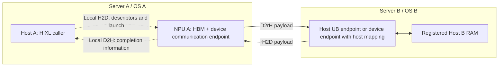

# 12 — D2rH and rH2D: remote host-memory traffic over UB

[Summary](README.md) · Previous: [HCCL/HCOMM collective traffic](11_hccl_hcomm_collective_traffic.md) · Next: [Transparent remote-memory encryption](13_transparent_remote_memory_encryption.md)

Analysis date: 2026-10-11. The main source is HIXL commit
`49bd2a256b728544c1e12df555c545670f9ab51a`, inspected in the earlier HIXL
checkout. HCOMM references use `f9f91c084`; the supporting runtime/driver
analysis uses `216912472` / `866e409`. These snapshots have not been validated
as one installed stack. No transfers or performance tests were run.

This document focuses on Ascend 950/A5 UB remote-memory transfers between
separate servers, using HIXL as the concrete application/library path.
HIXL source links are pinned to the inspected commit so this document does
not depend on the temporary location of its checkout.

## 1. Meaning of D2rH and rH2D

Assume server A and server B each have a host OS and eight NPUs. Let:

- **D** be memory on an NPU in server A, normally HBM.
- **rH** be host RAM owned by a process in server B.
- **r** mean remote relative to the transfer initiator's side.

| Direction, viewed from A | Example | Device-side operation in the selected path |
|---|---|---|
| **D2rH** | Offload KV-cache blocks from NPU A to registered host RAM on B | WRITE / Put: local device source → remote host destination |
| **rH2D** | Restore those blocks from host RAM on B into NPU A | READ / Get: remote host source → local device destination |

These are bulk payload transfers. They differ from the local H2D argument
uploads and local D2H completion reports that support their execution.
They also differ from a normal HCCL AllReduce on device buffers, whose
inter-server payload is D2D. See [the collective trace](11_hccl_hcomm_collective_traffic.md).

The same physical direction can have a different initiator. For NPU A →
Host B RAM, A can issue a WRITE, or B can issue a READ. For Host B RAM →
NPU A, A can issue a READ, or B can issue a WRITE. HIXL's benchmark calls the
B-initiated forms rD2H and H2rD. Direction alone does not determine the
initiator or the READ/WRITE opcode. [Direction definitions][directions]

An application can call HIXL on **Host A** while the selected transfer work
executes on **NPU A**. The CPU issuing the library call is distinct from the
endpoint executing the payload operation.

## 2. OS boundaries and UB connectivity

Different OS domains do not automatically mean different UB network
instances. Two servers can participate in the same UB fabric. Conversely,
having eight cards in each server does not establish that their Host and
Device endpoints can communicate.

The inspected HIXL selector compares `net_instance_id`. For the same instance
it can select UB_CTP endpoint groups; across instances it considers UBoE,
UB_RTP, and RoCE alternatives. Selection also depends on the configured
endpoints and supported protocols. A raw virtual address from server B
does not supply the endpoint, registration, or access information needed
to reach B's memory. [Selection rules][selection], [instance comparison][instance]



This is an endpoint diagram. Switches, routing, intermediate device access,
and the host-memory attachment depend on the selected arrangement below.

## 3. Two relevant UB arrangements

| Arrangement | How Host B RAM becomes reachable | Payload path at the endpoint level |
|---|---|---|
| **Device and Host UB endpoints** | Register B's host buffer against a supported Host UB endpoint; exchange/import its remote-memory description | NPU A endpoint ↔ Host B endpoint ↔ B's RAM |
| **Device endpoints with mapped host memory** | Map B's host buffer into a device-visible address, then register/export that mapping through B's device endpoint | NPU A endpoint ↔ NPU B endpoint ↔ mapped Host B RAM |

### 3.1 Device-to-Host endpoint pairing

HIXL explicitly classifies endpoint pairs as `COMM_TYPE_UB_D2D`,
`COMM_TYPE_UB_D2H`, `COMM_TYPE_UB_H2D`, or `COMM_TYPE_UB_H2H`.
The UB handler also classifies transfer descriptors using their registered
local and remote memory types. For a local device buffer and remote host
buffer it selects the device/host channel; WRITE versus READ then determines
the payload direction. The channel's `UB_D2H` name by itself does not force
every operation on it to be a WRITE. [Endpoint classes][endpoint-classes],
[memory classification][classify]

The inspected HIXL configuration describes `ub_ctp`, or the combination of
`ub_ctp:device` and `ub_ctp:host`, as using Device and Host UB resources for
the pure URMA path. HCOMM's 950 memory-registration contract includes Host
UB_CTP endpoints. Real endpoint identifiers, compatible software, and a
reachable topology are required. [Configuration][config],
[HCOMM registration contract](../../hcomm/docs/zh/api_ref/comm_opdev/control_plane_api/basic_resource_mgmt/HcommMemReg.md#L48)

### 3.2 Device endpoint with host-memory mapping

For the relevant Device endpoint configuration, HIXL performs:

```text
Host B owns a host buffer
  → aclrtHostRegister(host_buffer, size, ACL_HOST_REGISTER_MAPPED, &device_address)
  → register device_address through the device communication endpoint
  → export/import the communication-memory description
  → peer accesses the registered mapping
  → backing bytes are read/written in Host B RAM
```

`Endpoint::RegisterMem` changes the registration description to
`COMM_MEM_TYPE_DEVICE` and uses the mapped device address, while retaining
the original host-memory information. **This does not copy the buffer into
HBM.** Payload still terminates in host RAM. The transfer path converts
descriptors to the mapped addresses where required. [Registration][mapping],
[host registration call][host-register], [descriptor conversion][dispatch]

The inspected configuration describes the default/device-only UB_CTP
arrangement as mapping host memory and using Device UB links. This is
different from claiming that the separate HIXL `protocol_desc="ubmem"`
backend is selected: that option has its own product and transport constraints.
Check the exact configuration and release. [Configuration][config],
[server mapping selector][server-mapping]

The endpoint arrows establish the software addressing arrangement. They do
not establish every hardware hop, internal buffering action, or cache and
translation transaction. No separate application tensor copy into B's HBM
is introduced by the registration code shown here.

## 4. Setup and application use

The reusable setup consists of:

1. Initialize HIXL on both sides with the correct device context and
   communication resources.
2. Allocate the local device buffer on A and a supported host buffer on B.
   Register each buffer with the appropriate memory type and endpoint.
3. Establish the connection and exchange/import remote-memory descriptions.
   This includes the information required to access the registered regions;
   an application buffer address alone is insufficient.
4. Agree on the logical buffer/block identity, offsets, lengths, and ownership.
   The application must know which exported region holds each KV block.
5. Submit transfers, observe completion, and keep buffers, registrations,
   and mappings valid while operations remain outstanding.

HIXL forwards memory export/import to HCOMM for its HCOMM endpoint backend.
Mapped host-memory exports also carry the mapped-address information needed
by the peer. [HCOMM adapter][mem-adapter], [exported mapping metadata][export],
[import processing][import]

For example, after setup, the descriptor used on A can be understood as:

```text
local_addr  = NPU A buffer address
remote_addr = agreed/exported Host B buffer address
len         = bytes to transfer

TransferAsync(peer_B, WRITE, descriptors, ...)  → D2rH offload
TransferAsync(peer_B, READ,  descriptors, ...)  → rH2D restore
GetTransferStatus(request, status)            → wait for completion or failure
```

This is an API sketch, not a complete runnable sample. For WRITE, the local
address is the source; for READ, it is the destination. Source production
must finish before the transfer, and consumers must wait for its completion.
HIXL's D2rH example constructs a local device address and peer host address
and issues WRITE. That example itself runs two engines in one process;
the benchmark separately supports dual-machine runs. [D2rH example][example],
[benchmark modes][directions], [async API][async-api]

## 5. Device-executed transfer path and its local traffic

For the selected Device endpoint path, the inspected call chain is:

```text
Host A: Hixl::TransferAsync(peer_B, WRITE or READ, descriptors, ...)
  → selected client handler
      UB endpoint-group case: UbClientHandler::TransferAsync
        → classify registered memory types and select channel
        → HixlCSClientBatchPutAsync / HixlCSClientBatchGetAsync
  → HixlCSClient::BatchTransferAsync
      → convert mapped-host descriptors, when required
      → BatchTransferDeviceAsync
          → AllocateDeviceDescBuf
              aclrtMemcpy(H2D): descriptor array → NPU A
          → LaunchDeviceChunkedKernels
              aclrtKernelArgsAppend + aclrtLaunchKernelWithConfig
              HixlBatchPut / HixlBatchGet

Device AICPU:
  → HcommBatchTransferOnThread with WRITE / READ descriptors
      or HcommWriteOnThread / HcommReadOnThread fallback
  → selected HCOMM transport executes the communication work
  → HcommChannelFenceOnThread + completion-ordering work
```

The UB handler maps WRITE to Put and READ to Get. The device kernel prefers
the HCOMM batch primitive and falls back to individual primitives when the
batch interface returns `HCCL_E_NOT_SUPPORT`. Its transfer pool allocates an
`AICPU_TS` communication thread. [Handler dispatch][handler],
[Device/Host dispatch][dispatch], [descriptor upload][desc-upload],
[kernel launch][launch], [device primitives][kernel], [thread selection][pool]

For the selected HCOMM 950 UB path, the lower layer constructs Jetty work
and submits UB doorbell tasks through device STARS queues, as traced in
[chapter 11](11_hccl_hcomm_collective_traffic.md#44-communication-wqes-are-produced-by-aicpu).
Those device-generated descriptors are separate from Host A's H2D launch
traffic. Connecting these source snapshots does not establish binary
compatibility for an installed HIXL/HCOMM/runtime combination.

For `n` descriptors, `AllocateDeviceDescBuf` copies
`n × sizeof(HixlOneSideOpDesc)` bytes H2D. Each kernel receives a
`HixlOneSideOpParam` containing thread/channel handles, descriptor-array
address, count, and completion information. The inspected code limits each
kernel chunk to 128 descriptors and also honors a configurable logical
batch boundary. These are descriptor counts, not a 128-byte payload limit.
[Descriptor upload and chunking][desc-upload], [chunk selector][chunks]

## 6. Completion, polling, and buffer lifetime

There are several distinct completion points:

| Boundary | Meaning |
|---|---|
| `TransferAsync` returns successfully | The request was submitted; its payload may still be in flight |
| HCOMM channel ordering/fence and batch completion work | Establishes the transport/task ordering needed by the selected device path |
| HIXL request reports `COMPLETED` | The application can act on completion of that request under the API contract |
| Remote application consumes the buffer | Requires application coordination; submission alone does not notify it that its data is ready |

In `BatchTransferDeviceAsync`, HIXL queues an explicit
`aclrtMemcpyAsync(..., sizeof(uint64_t), DEVICE_TO_HOST, stream)` after the
device work and its Notify waits. It copies a constant one into a local
host completion flag. `CheckStatusDevice` polls this flag and checks error
state. **This is 8 bytes of local D2H completion payload, independent of the
potentially large D2rH/rH2D payload.** It is not a complete count of all
completion traffic. [Async completion copy][device-async],
[completion polling][status]

The synchronous Device path instead waits with
`aclrtSynchronizeStreamWithTimeout`. The device kernel's UB path can also
READ a remote flag after fencing transfer work, as part of completion
ordering. Thus control READs may accompany a large WRITE payload.
[Synchronous path][device-sync], [device fence/flag work][kernel-completion]

An interrupt is not synonymous with request completion. The observed HIXL
status query polls host-visible state; runtime/transport notification below
it may use their own polling or event mechanisms. This trace does not imply
one host interrupt per transfer.

Producer/consumer ordering must include both applications. For KV offload,
A must finish writing the source KV blocks before submission, and B must
not reuse the destination until the owning protocol permits it. For restore,
B must keep the source stable and A must wait before an attention kernel
reads the restored HBM buffer. The HIXL API requires querying asynchronous
requests; in this snapshot terminal status queries release request resources
and must not be repeated on the same request. [Status contract][status-api]

## 7. Traffic inventory and a KV-cache example

| Traffic | Endpoints | Contents / frequency |
|---|---|---|
| Registration, connection, memory-description exchange | Control endpoints on A/B and their local devices | Setup or resource changes; transport depends on the service |
| Descriptor-array upload | Host A → NPU A | H2D in the selected Device execution path |
| Kernel arguments and task submission | Host A → NPU A | Launch metadata, possibly for multiple descriptor chunks |
| D2rH payload | NPU A → Host B RAM | The actual offloaded tensor/KV bytes |
| rH2D payload | Host B RAM → NPU A | The actual restored tensor/KV bytes |
| Remote completion-ordering reads/notifies | Selected communication endpoints | Additional control traffic; depends on path and batch boundaries |
| Async local completion flag | NPU A → Host A | An explicit 8-byte D2H copy in the inspected Device async path |
| Application readiness/ownership notification | Application-defined A↔B control path | Coordinates remote consumers and buffer reuse |

For an illustrative 16 MiB KV block, offload moves 16 MiB from NPU A to
Host B RAM; restore moves 16 MiB back. That is **32 MiB of end-to-end payload**
for the round trip, plus setup, descriptors, launch, protocol, and completion
traffic. It is not necessarily 32 MiB on every physical link: the mapped-host
arrangement can traverse both an inter-NPU link and B's host-memory attachment.

Remote host RAM can provide a KV storage tier. For bulk offload/restore,
registration and connection reuse amortize setup; batching amortizes launch
and descriptor costs. This source trace does not show that an attention
kernel should repeatedly read remote RAM directly, or establish that a given
fabric meets a serving latency/bandwidth target. See the separate
[mapped host-memory and KV-cache analysis](07_host_memory_access_and_kv_cache.md)
for that tradeoff.

For measurement, record both **physical memory placement** and **selected
endpoint/protocol**. A registered device address can map host RAM, so the
registration type alone can misclassify end-to-end D2rH/rH2D as D2D.

## 8. What is established and what remains deployment-dependent

Established by the inspected source:

- HIXL has explicit UB device/host channel classification and remote-host
  READ/WRITE use cases.
- Host registration/mapping can expose host RAM through a Device endpoint.
- The selected Device transfer path adds local H2D descriptors/kernel launches
  and, for async requests, an explicit local D2H completion flag.
- Normal HCCL device-buffer collectives and explicit remote-host transfers
  are separate application uses of the communication stack.

Deployment-dependent or outside this trace:

- Whether the two servers have a reachable, supported Host/Device endpoint
  combination and which same-instance or cross-instance transport is selected.
- The complete hardware route, translation/cache behavior, packet overhead,
  and buffering inside external UB/URMA providers.
- Every Host-initiated, UBoE, UB_RTP, RoCE, or separate UBMEM backend path.
- Measured bandwidth, latency, overlap, failure recovery, and safe reclamation
  after transport failure on a matched installed stack.

## Source references

[directions]: https://gitcode.com/cann/hixl/blob/49bd2a256b728544c1e12df555c545670f9ab51a/benchmarks/README_en.md#L168
[selection]: https://gitcode.com/cann/hixl/blob/49bd2a256b728544c1e12df555c545670f9ab51a/src/hixl/engine/endpoint_matcher.cc#L36
[instance]: https://gitcode.com/cann/hixl/blob/49bd2a256b728544c1e12df555c545670f9ab51a/src/hixl/engine/endpoint_matcher.cc#L128
[endpoint-classes]: https://gitcode.com/cann/hixl/blob/49bd2a256b728544c1e12df555c545670f9ab51a/src/hixl/engine/endpoint_matcher.cc#L81
[classify]: https://gitcode.com/cann/hixl/blob/49bd2a256b728544c1e12df555c545670f9ab51a/src/hixl/engine/ub_client_handler.cc#L687
[config]: https://gitcode.com/cann/hixl/blob/49bd2a256b728544c1e12df555c545670f9ab51a/docs/zh/api/cpp/HIXL-interface.md#L312
[mapping]: https://gitcode.com/cann/hixl/blob/49bd2a256b728544c1e12df555c545670f9ab51a/src/hixl/cs/endpoint.cc#L221
[host-register]: https://gitcode.com/cann/hixl/blob/49bd2a256b728544c1e12df555c545670f9ab51a/src/hixl/cs/host_register_proxy.cc#L118
[dispatch]: https://gitcode.com/cann/hixl/blob/49bd2a256b728544c1e12df555c545670f9ab51a/src/hixl/cs/hixl_cs_client.cc#L1028
[server-mapping]: https://gitcode.com/cann/hixl/blob/49bd2a256b728544c1e12df555c545670f9ab51a/src/hixl/cs/hixl_cs_server.cc#L80
[mem-adapter]: https://gitcode.com/cann/hixl/blob/49bd2a256b728544c1e12df555c545670f9ab51a/src/hixl/cs/hcomm_endpoint.cc#L39
[export]: https://gitcode.com/cann/hixl/blob/49bd2a256b728544c1e12df555c545670f9ab51a/src/hixl/cs/hixl_cs_server.cc#L547
[import]: https://gitcode.com/cann/hixl/blob/49bd2a256b728544c1e12df555c545670f9ab51a/src/hixl/cs/hixl_cs_client.cc#L154
[example]: https://gitcode.com/cann/hixl/blob/49bd2a256b728544c1e12df555c545670f9ab51a/examples/cpp/hixl_example_d2rh.cpp#L239
[async-api]: https://gitcode.com/cann/hixl/blob/49bd2a256b728544c1e12df555c545670f9ab51a/docs/zh/api/cpp/HIXL-interface.md#L837
[handler]: https://gitcode.com/cann/hixl/blob/49bd2a256b728544c1e12df555c545670f9ab51a/src/hixl/engine/ub_client_handler.cc#L452
[desc-upload]: https://gitcode.com/cann/hixl/blob/49bd2a256b728544c1e12df555c545670f9ab51a/src/hixl/cs/hixl_cs_client.cc#L798
[launch]: https://gitcode.com/cann/hixl/blob/49bd2a256b728544c1e12df555c545670f9ab51a/src/hixl/cs/hixl_cs_client.cc#L851
[kernel]: https://gitcode.com/cann/hixl/blob/49bd2a256b728544c1e12df555c545670f9ab51a/src/ops/hixl_kernel/hixl_batch_transfer.cc#L36
[pool]: https://gitcode.com/cann/hixl/blob/49bd2a256b728544c1e12df555c545670f9ab51a/src/hixl/cs/transfer_pool.cc#L33
[chunks]: https://gitcode.com/cann/hixl/blob/49bd2a256b728544c1e12df555c545670f9ab51a/src/hixl/cs/hixl_cs_client.cc#L751
[device-async]: https://gitcode.com/cann/hixl/blob/49bd2a256b728544c1e12df555c545670f9ab51a/src/hixl/cs/hixl_cs_client.cc#L895
[status]: https://gitcode.com/cann/hixl/blob/49bd2a256b728544c1e12df555c545670f9ab51a/src/hixl/cs/hixl_cs_client.cc#L1132
[device-sync]: https://gitcode.com/cann/hixl/blob/49bd2a256b728544c1e12df555c545670f9ab51a/src/hixl/cs/hixl_cs_client.cc#L951
[kernel-completion]: https://gitcode.com/cann/hixl/blob/49bd2a256b728544c1e12df555c545670f9ab51a/src/ops/hixl_kernel/hixl_batch_transfer.cc#L105
[status-api]: https://gitcode.com/cann/hixl/blob/49bd2a256b728544c1e12df555c545670f9ab51a/docs/zh/api/cpp/HIXL-interface.md#L897
