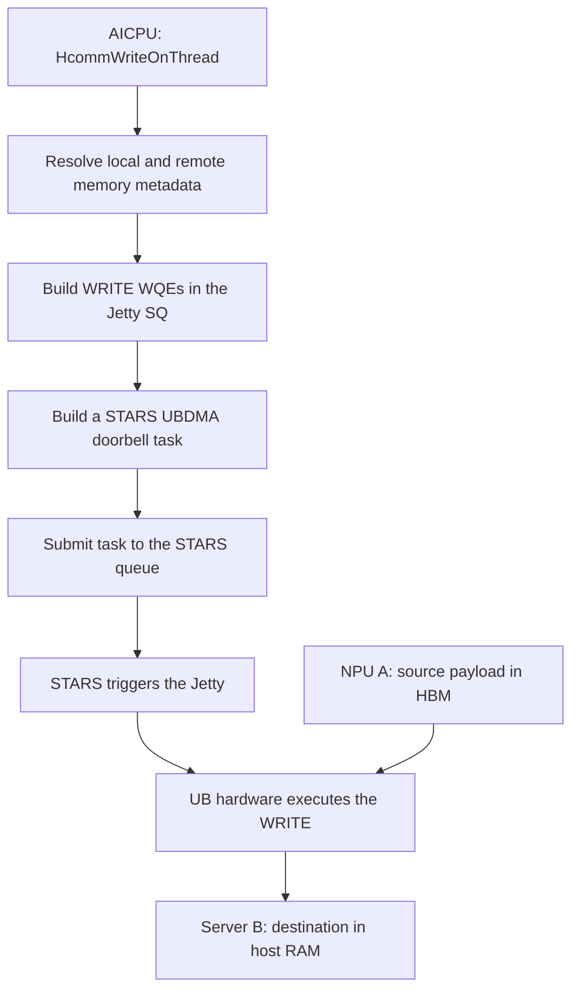

# 14 — HcommWriteOnThread: AICPU, Jetty WQEs, and STARS over UB

[Summary](README.md) · Previous: [Transparent remote-memory encryption](13_transparent_remote_memory_encryption.md) · Next: [HcommWriteNbiOnThread over host RoCE](15_hcomm_write_nbi_on_thread.md)

Analysis date: 2026-10-13. Source: HCOMM
`f9f91c08434fffac4c0bd754a93d10f6665fc1a8` in the sibling checkout.
This is a source trace of the Ascend 950/A5 AICPU UB path, not a hardware
measurement or a claim about every implementation of the API.

## 1. What this function does

`HcommWriteOnThread` prepares an asynchronous, one-sided remote write.
AICPU builds the transfer descriptors, STARS schedules their execution,
and UB hardware moves the payload. Two queues participate:

| Queue | Descriptor | Purpose |
|---|---|---|
| Jetty SQ | UB WRITE WQE | Specifies source, destination, byte count, registration tokens, and ordering |
| Stream RTSQ | STARS UBDMA doorbell SQE | Triggers the specified Jetty through a producer index at this point in stream execution |

The payload stays in its registered source buffer until hardware reads it.
It is not copied into either queue. [API entry][entry], [transport WRITE][transport-write].



The payload endpoints in this diagram illustrate D2rH. The function can
describe other memory-direction combinations when the selected channel and
registrations support them; its signature does not intrinsically mean D2H.

## 2. Protocol and execution scope

The repository's Ascend 950 API documentation lists **UB_CTP and UBoE** for
`HcommWriteOnThread`. The detailed trace below follows `UbTransportLiteImpl`
and `UbConnLite`. [Documented support][write-doc].

There are different host and AICPU definitions of the same symbol:

- The AICPU build includes `aicpu_ts_primitives_c_adpt.cc`; its A5 branch
  obtains a `BaseTransportLiteImpl` and calls its virtual `Write` operation.
- The host build includes `cpu_primitives_c_adpt.cc`; that implementation
  dispatches through a NIC plugin or the `HcclRemoteWrite` stream path.
- The channel factory contains additional engine/protocol combinations.
  Their existence does not expand the documented support contract for this
  API without further validation.

Thus, “our `HcommWriteOnThread` path uses UB” is accurate. “The function name
itself hardwires every build to UB” is too broad. Compare the separately
documented host RoCE NBI path in [document 15](15_hcomm_write_nbi_on_thread.md).
[Build selection][build], [host entry][host-entry], [channel factory][factory].

### Does the payload pass through a NIC?

The API name establishes neither the entire physical route nor the absence
of adapters. For the selected UB_CTP arrangement with a reachable Host UB
endpoint, the logical payload path is:

```text
NPU A HBM -> NPU A UB engine/port -> native UB fabric
         -> Host B UB endpoint/memory attachment -> Host B RAM
```

This path does not require the host RoCE `ibv_post_send`/QP transport described
in document 15. It still uses UB interface hardware and may traverse switches.
The destination is registered memory; a remote CPU thread does not have to
receive and copy every payload as part of the one-sided WRITE.
`AicpuTsUrmaChannel::BuildConnection` selects `DevUbCtpConnection`, which
sets `TpProtocol::CTP`. [Channel setup][channel-setup], [protocol selection][ub-protocols].

Host memory can also be exposed through a remote device endpoint:

```text
NPU A UB endpoint -> native UB fabric -> NPU B UB endpoint
                 -> registered mapping backed by Host B RAM
```

That registration does not itself copy the host buffer into NPU B's HBM.
These endpoint arrangements, their configuration, and the limits on what
they establish about hardware hops are covered in
[document 12, section 3](12_remote_host_memory_d2rh_rh2d.md#3-two-relevant-ub-arrangements).

For UBoE, HCOMM instead creates `DevUbUboeConnection` with EID/IP information
and selects `TpProtocol::UBOE`. [UBoE setup][uboe-setup], [protocol selection][ub-protocols].
The public UBoE Internet-Draft describes UB carried over Ethernet/IP, with
either encapsulation at UBoE endpoints/NICs or conversion by UB2E switches.
It is an informational draft, not an adopted IETF standard or evidence of
the exact equipment installed here. [UBoE deployment models][uboe-draft].

Accordingly, “direct over UB” is appropriate for the logical UB_CTP memory
access when that topology is available. “Every HcommWriteOnThread bypasses
all NICs and network hardware” is not established. Across different UB
network instances, HIXL may select a different protocol; a different OS
domain alone does not determine that choice. See
[document 12, section 2](12_remote_host_memory_d2rh_rh2d.md#2-os-boundaries-and-ub-connectivity).

## 3. Parameters and prerequisites

```cpp
int32_t HcommWriteOnThread(
    ThreadHandle thread, ChannelHandle channel,
    void* dst, const void* src, uint64_t len);
```

| Argument | Interpretation in this path |
|---|---|
| `thread` | HCOMM execution resource associated with a device stream; no OS thread is created by this call |
| `channel` | Established peer connection and local/remote registered-memory metadata |
| `src` | Local source address |
| `dst` | Remote destination address, interpreted through the channel's remote-memory metadata |
| `len` | Payload length in bytes |

For D2rH, `src` can identify NPU A's registered device memory and `dst`
server B's registered host memory. The caller must already have established
the channel and made the memory descriptions available to it. Registration,
connection creation, and payload allocation are not performed by this call.
See [the remote-memory setup discussion](12_remote_host_memory_d2rh_rh2d.md).

The source producer must have finished before the write executes, and the
source must remain valid and unchanged until the appropriate completion.
The remote address is encoded in a descriptor; the local CPU does not
dereference it as an ordinary local pointer.

## 4. Entry point and registered-buffer lookup

The AICPU entry performs null checks, unwraps the channel handle if it is
an `HcommAicpuChannelCtx`, and records the thread in batch-launch bookkeeping.
`AddThread` does not start a thread or move payload. [Handle helper][unwrap],
[batch bookkeeping][add-thread].

The A5 branch then performs the following sequence:

```text
thread -> StreamLite
channel -> BaseTransportLiteImpl
BuildLocRmaBufferLite(src, len, localDescriptor)
Buffer remoteDescriptor(dst, len)
transport->Write(localDescriptor, remoteDescriptor, stream)
```

`BuildLocRmaBufferLite` associates the local address range with registration
token metadata. `UbTransportLiteImpl::Write` resolves the remote range using
`GetRmtRmaBufSliceLite`:

```text
Local WQE input:  address + length + token ID
Remote WQE input: address + length + token ID + token value
```

These are memory-access registration credentials, not encryption keys.
[Local lookup][local-lookup], [remote lookup][remote-lookup].

### Lookup caveat relevant to staging

The local lookup is not a strict range validator. If its map is nonempty
but no entry contains the requested range, it logs a warning and constructs
the descriptor using the first entry's token metadata. An empty map returns
an error. The remote lookup instead throws when no containing range exists.

This does not establish what hardware will permit; downstream enforcement
has not been audited here. It does mean that encryption staging must be
registered and associated with the correct metadata explicitly, rather than
treating local-lookup success as a security bounds check. [Fallback][local-lookup].

## 5. Build the UB WRITE WQEs

```text
UbTransportLiteImpl::Write
  -> SetFenceConfig
  -> select connVec[0]
  -> resolve local and remote slices
  -> UbConnLite::Write
       -> ProcessSlices(..., maxWriteSize, ...)
            -> FillOneSqeWrite(..., UDMA_OPC_WRITE, ...)
            -> ProcessOneWqe
                 -> LaunchOneWqe
  -> BuildUbDbSendTask(..., final producer index)
```

This transport uses connection zero for the shown operation. Its cache
hooks run before and after WQE preparation; `PostLaunchWqe` deliberately runs
before the doorbell task can trigger immediate STARS submission. Task-cache
replay is an additional integration concern for crypto, because replay must
not assume that the public C entry is invoked again. [Transport WRITE][transport-write].

### Transfer size and descriptor fields

For nonzero `len`, `ProcessSlices` constructs
`ceil(len / maxWriteSize)` WQEs. Each slice advances the source and remote
addresses by the same offset. The selected channel obtains `maxWriteSize`
from device capabilities; it is not one universal size fixed by the API.
The function checks queue capacity before placing the WQEs, and can wait
for space. [Slicing][slices], [capability setup][channel-setup], [backpressure][queue-space].

| WQE content | Source or purpose |
|---|---|
| Opcode | `UDMA_OPC_WRITE` |
| Local SGE | Source address, byte length, local token ID |
| Remote target | Destination address, remote token ID/value, endpoint and transport information |
| Ordering | Placement/completion ordering and fence bits |
| Completion request | Enabled on the last or only slice when configured |
| Inline payload | Disabled: `inlineEn = 0` |

The ordinary WRITE remains non-inline even for small payloads. Separate
inline-write helpers exist, but this function does not automatically switch
to them just because `len` is small. [Common fields][wqe-common],
[WRITE fields][wqe-write], [local SGE][local-sge].

In ordinary noncached execution, `LaunchOneWqe` places a 64-byte descriptor
at `sqVa_ + (pi % sqDepth_) * 64` and advances `pi`. The descriptor copy is
a local queue update, not a copy of the user's tensor or KV-cache bytes.
`pi` is the Jetty producer index passed to the later doorbell task.
[Queue insertion][queue-insert].

## 6. Build and submit the separate STARS task

After all slices are prepared:

```text
BuildUbDbSendTask
  -> RtsqA5::UbDbSend(jetty, finalPi, sequence, transport)
       -> BuildA5SqeUbDbSend
       -> RefreshInfo
```

The STARS descriptor has type `UBDMA`, mode `DOORBELL_MODE`, and one
doorbell entry carrying Jetty ID, function ID, die ID, and producer index.
The payload addresses and lengths are in the UB WQEs, not this doorbell SQE.
One logical write can therefore produce several UB WQEs and one STARS
doorbell task covering them. [Doorbell construction][doorbell-build],
[STARS fields][stars-fields].

Submission proceeds through:

```text
RtsqA5::LaunchTask
  -> CopySqeBufToSq
  -> ConfigSqTail
       -> halSqCqConfig(... DRV_SQCQ_PROP_SQ_TAIL ...)
```

This is device-side AICPU submission. It is not another host `halSqSend`
invocation for every write. Host work needed to launch the enclosing AICPU
kernel is a separate stage. [Launch][launch], [tail update][tail].

With launching enabled, eager mode may submit immediately. Batch mode
retains pending SQEs until a flush, including the capacity-triggered flush
or the transition back to eager mode at `HcommBatchModeEnd`.
[Launch policy][launch-policy], [batch APIs][batch-api], [batch flush][batch-flush].

When STARS executes the doorbell task, the expected hardware behavior is
that the UB engine consumes the indicated WQEs, reads the registered source,
and writes the remote destination. This is the hardware contract reflected
by these descriptors, not a packet-level hardware trace.

## 7. Return, ordering, and completion are different stages

| Event | Meaning |
|---|---|
| C function returns success | Preparation/submission succeeded according to the current launch mode |
| Pending STARS SQEs are flushed | The task is made available to device scheduling |
| Transport/task completion | The relevant hardware work has completed according to its completion contract |
| Queue credits reclaimed | Queue slots can be reused |
| Remote application consumes the buffer | Requires the application's or library's readiness/synchronization protocol |

The selected connection uses `STARS_POLL` JFC mode. Software also polls
RTSQ head progress, associates completed doorbell slots with sequence/PI
values, and calls `UpdateCi` through `UbConnLiteMgr` to reclaim Jetty credits.
This bookkeeping must not be equated with remote application consumption,
or its polling interval interpreted as the transfer latency.
[Connection mode][channel-setup], [completion tracking][completion], [CI update][ci-update].

The UB implementation of `HcommChannelFenceOnThread` calls `Fence`, which
sets `fence_ = true` and returns. `SetFenceConfig` consumes that state on the
next operation to configure strong placement/completion ordering. The fence
call itself is not a CPU wait for payload completion. This differs from
the host RoCE fence in document 15. [Fence entry][fence-entry], [fence state][fence].

Ordinary WRITE uses the remote destination address directly. It does not
post a matching application RECV or automatically invoke a remote-host
callback. Higher-level notification and completion operations supply that
coordination where needed.

## 8. Consequences for transparent encryption

The dispatch point before buffer resolution can route a logical write into
a secure engine:

```text
Device plaintext
  -> encrypt into registered local ciphertext staging
  -> build WRITE descriptors for local and remote staging
  -> UB WRITE to registered remote ciphertext staging
  -> remote host decrypts into the application destination
  -> publish application-visible completion
```

The secure engine must preserve producer ordering, staging lifetime, valid
registration metadata, and completion semantics. Existing UB transport
completion does not automatically include remote-host decryption. A remote
worker and acknowledgement must participate in the library's completion
protocol. The details and scoped interception inventory are in
[document 13](13_transparent_remote_memory_encryption.md).

This trace changes no runtime or HCOMM implementation. Exact hardware
coherency, provider behavior, failure quiescence, task-cache replay, and
performance require additional validation before implementing that design.

## Source references

[entry]: ../../hcomm/src/base_comm/primitives/api_c_adpt/aicpu_ts_primitives_c_adpt.cc#L433
[write-doc]: ../../hcomm/docs/zh/api_ref/comm_opdev/data_plane_api/cpu-cpu_ts-aicpu_ts/communication_operations/HcommWriteOnThread.md#L45
[build]: ../../hcomm/src/base_comm/primitives/api_c_adpt/CMakeLists.txt#L25
[host-entry]: ../../hcomm/src/base_comm/primitives/api_c_adpt/cpu_primitives_c_adpt.cc#L281
[factory]: ../../hcomm/src/base_comm/resources/endpoint_pairs/channels/channel.cc#L38
[unwrap]: ../../hcomm/src/base_comm/resources/endpoint_pairs/channels/aicpu/aicpu_ts_channel_helper.h#L69
[add-thread]: ../../hcomm/src/base_comm/primitives/launch_context.h#L40
[local-lookup]: ../../hcomm/src/legacy/ascend950/unified_platform/resource/transport/aicpu/ub_transport_lite_impl.cc#L314
[remote-lookup]: ../../hcomm/src/legacy/ascend950/unified_platform/resource/transport/aicpu/ub_transport_lite_impl.cc#L293
[transport-write]: ../../hcomm/src/legacy/ascend950/unified_platform/resource/transport/aicpu/ub_transport_lite_impl.cc#L669
[slices]: ../../hcomm/src/legacy/ascend950/unified_platform/resource/connection/aicpu/ub_conn_lite.cc#L117
[channel-setup]: ../../hcomm/src/base_comm/resources/endpoint_pairs/channels/aicpu/aicpu_ts_urma_channel.cc#L99
[queue-space]: ../../hcomm/src/legacy/ascend950/unified_platform/resource/connection/aicpu/ub_conn_lite.cc#L804
[wqe-common]: ../../hcomm/src/legacy/ascend950/unified_platform/resource/connection/aicpu/ub_conn_lite.cc#L49
[wqe-write]: ../../hcomm/src/legacy/ascend950/unified_platform/resource/connection/aicpu/ub_conn_lite.cc#L228
[local-sge]: ../../hcomm/src/legacy/ascend950/unified_platform/resource/connection/aicpu/ub_conn_lite.cc#L466
[queue-insert]: ../../hcomm/src/legacy/ascend950/unified_platform/resource/connection/aicpu/ub_conn_lite.cc#L253
[doorbell-build]: ../../hcomm/src/legacy/ascend950/unified_platform/resource/transport/aicpu/ub_transport_lite_impl.cc#L265
[stars-fields]: ../../hcomm/src/legacy/ascend950/unified_platform/resource/stream/aicpu/sqe_build_a5.h#L190
[launch]: ../../hcomm/src/legacy/ascend950/unified_platform/resource/stream/aicpu/rtsq_a5.cc#L225
[tail]: ../../hcomm/src/legacy/ascend950/unified_platform/resource/stream/aicpu/rtsq_base.cc#L110
[launch-policy]: ../../hcomm/src/legacy/ascend950/unified_platform/resource/stream/aicpu/rtsq_a5.cc#L360
[batch-api]: ../../hcomm/src/base_comm/primitives/api_c_adpt/aicpu_ts_primitives_c_adpt.cc#L1051
[batch-flush]: ../../hcomm/src/base_comm/primitives/launch_context.cc#L23
[completion]: ../../hcomm/src/legacy/ascend950/unified_platform/resource/stream/aicpu/rtsq_a5.cc#L616
[ci-update]: ../../hcomm/src/legacy/ascend950/unified_platform/resource/connection/aicpu/ub_conn_lite_mgr.cc#L74
[fence-entry]: ../../hcomm/src/base_comm/primitives/api_c_adpt/aicpu_ts_primitives_c_adpt.cc#L1110
[fence]: ../../hcomm/src/legacy/ascend950/unified_platform/resource/transport/aicpu/ub_transport_lite_impl.cc#L1483
[ub-protocols]: ../../hcomm/src/legacy/ascend950/unified_platform/resource/connection/dev_ub_connection.cc#L124
[uboe-setup]: ../../hcomm/src/base_comm/resources/endpoint_pairs/channels/aicpu/aicpu_ts_uboe_channel.cc#L52
[uboe-draft]: https://www.ietf.org/archive/id/draft-li-uboe-00.html#section-3
