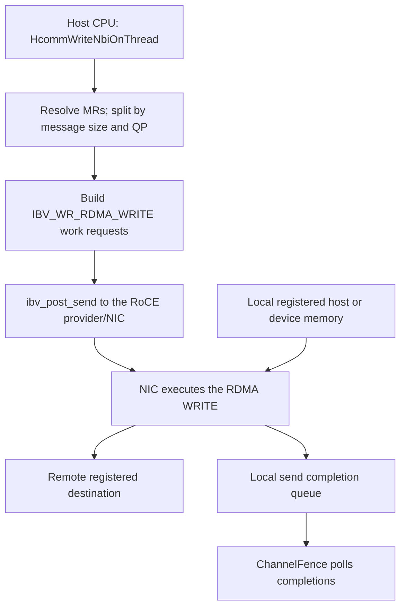

# 15 — HcommWriteNbiOnThread: host RoCE submission and completion

[Summary](README.md) · Previous: [HcommWriteOnThread over UB](14_hcomm_write_on_thread.md)

Analysis date: 2026-10-13. Source: HCOMM
`f9f91c08434fffac4c0bd754a93d10f6665fc1a8` in the sibling checkout.
The HIXL caller is at `49bd2a256b728544c1e12df555c545670f9ab51a`;
its links below are pinned upstream. This is source analysis, not an
installed-stack compatibility or hardware-performance validation.

## 1. Is WriteOnThread UB and WriteNbiOnThread RoCE?

**For the documented Ascend 950 paths under discussion, yes.** The
repository documents `HcommWriteOnThread` for UB_CTP/UBoE and
`HcommWriteNbiOnThread` for Host CPU execution using RoCE. The NBI document
explicitly excludes UB_CTP for NBI READ/WRITE, even though its more general
channel-creation sentence mentions both protocols. [WRITE contract][write-doc],
[NBI contract][nbi-doc].

However, this is a support/selected-backend statement, not a universal
encoding of the transport in the function name:

| Aspect | Selected `HcommWriteOnThread` path | Selected `HcommWriteNbiOnThread` path |
|---|---|---|
| Software executor | AICPU | Host CPU |
| Engine | AICPU_TS | CPU |
| Transport | UB WRITE through Jetty resources | RoCE RDMA WRITE through NIC QPs |
| Scheduling | Jetty WQEs plus a STARS doorbell SQE | Host posts WRs through `ibv_post_send` |
| `thread` | Identifies the stream execution resource | Ignored by the built-in implementation; pass zero |
| Return success | Prepared/submitted according to launch mode | Write requests posted successfully |
| Selected fence behavior | Sets ordering on the next operation | Waits for outstanding WR completions, then sets the next fence flag |

Both transfers are asynchronous with respect to payload completion. The
absence of `Nbi` in `WriteOnThread` does not make it a synchronous memcpy.

### Source-level qualification: host URMA also exists

The host NBI entry dispatches through `channel->GetNicOps()`. Built-in
channels install `g_BuiltinChannelOps`, whose `writeNbiOnThread` calls the
channel's virtual `Write` method. The factory selects:

```text
COMM_ENGINE_CPU + COMM_PROTOCOL_ROCE
  -> HostCpuRoceChannel

COMM_ENGINE_CPU + COMM_PROTOCOL_UB_CTP / COMM_PROTOCOL_UBC_TP
  -> HostCpuUrmaChannel
```

`HostCpuUrmaChannel::Write` has an implementation that posts `URMA_OPC_WRITE`
through `HrtUrmaPostJettySendWr`. The adapter and built-in NBI wrapper do not
themselves impose a RoCE-only protocol check. This is source-level dispatch
evidence for a host URMA route; it is not proof that NBI over UB_CTP is a
supported or validated product configuration. The published-in-repository
NBI restriction and the broader implementation must be kept distinct.
External NIC plugins can also supply their own operation implementations.
[Entry][entry], [binding][binding], [built-in dispatch][builtin],
[factory][factory], [host URMA implementation][host-urma].

The AICPU definition of `HcommWriteNbiOnThread` returns
`HCCL_E_NOT_SUPPORT` after pointer checks in this snapshot.
[AICPU stub][aicpu-stub]. The rest of this document follows the built-in
**host RoCE** implementation.

## 2. Prerequisites and parameters

```cpp
int32_t HcommWriteNbiOnThread(
    ThreadHandle thread, ChannelHandle channel,
    void* dst, const void* src, uint64_t len);
```

For the documented host path:

- Use a ready channel created with `COMM_ENGINE_CPU` and RoCE endpoints.
- `src` must be in locally registered memory.
- `dst` must identify remote imported/associated registered memory.
- `len` is a positive byte count under the API contract.
- `thread` has no effect in this built-in implementation and can be zero.
- Calls sharing one channel must obey the documented serialization rule.

Memory registration and connection establishment precede the write. The
channel setup obtains local memory handles and NIC capabilities, creates
connection resources, exchanges registration/connection descriptions, and
progresses QPs to a ready state. `HcommWriteNbiOnThread` does not allocate
pinned payload memory, register a new MR, or create a new thread per call.
[Contract][nbi-doc], [setup][setup], [connection readiness][ready].

Host execution does not imply host-to-host payload. The RoCE registration
manager handles host and device memory, including a special device-allocation
registration path. Consequently, a supported registered device source and
remote host destination can describe D2rH even though the initiating code
runs on the host CPU. The concrete NIC, driver, memory registration, and
topology must support those addresses. [Registration][mem-reg].

## 3. Entry and dispatch

The public host entry is a thin adapter:

```cpp
auto* ch = CHANNEL_FROM_HANDLE(channel);
return ch->GetNicOps()->writeNbiOnThread(
    ch->GetNicCtx(), thread, dst, src, len);
```

For a built-in host RoCE channel, the connected call chain is:

```text
HcommWriteNbiOnThread
  -> g_BuiltinChannelOps.writeNbiOnThread
  -> BuiltinWriteNbiOnThread
  -> BuiltinRwNbiOnThread
  -> HostCpuRoceChannel::Write
  -> PostRdmaOp(..., IBV_WR_RDMA_WRITE, ...)
  -> BuildRdmaWr
  -> PostAndCheckSend
  -> ibv_post_send
```

`BuiltinRwNbiOnThread` checks pointers and the device family, ignores
`thread`, and propagates `HCCL_E_AGAIN` without treating it as a final
network failure. It calls the backend immediately; this path does not
append work to the AICPU STARS batching mechanism.
[Host entry][entry], [built-in wrapper][builtin], [WRITE implementation][write].

## 4. Split the transfer and resolve memory keys

`HostCpuRoceChannel::Write` loops over chunks of at most `maxMsgSize_`.
That value comes from the RoCE endpoint's queried capabilities, not a
constant defined by the NBI API. Each chunk is submitted to `PostRdmaOp`.
[Capability query][setup], [chunk loop][write].

For each chunk, `PostRdmaOp` checks that QPs and memory-buffer lists exist,
then searches for local and remote registered regions containing the
requested address ranges. The lookups return `HCCL_E_NOT_FOUND` when no
matching region is found. The selected regions supply the local `lkey`
and remote `rkey`. This describes the implemented lookups, not a full
integer-overflow or security audit of their range calculations.
[Operation preparation][post-op], [buffer lookups][buffer-lookup].

The chunk is then divided across QPs. The requested queue count, NIC
capabilities, and `roceAttr.qpThreshold` influence the configuration and
number of QPs carrying payload. For illustration only, a chunk of 8 MiB
distributed evenly over two active QPs produces two 4 MiB payload WRs.
This example assumes the capability and threshold settings permit it.

An implementation detail matters for exact accounting: the loop still visits
all configured QPs. QPs outside `useQpNum` receive a WR with zero payload
length. Thus, counting only nonempty slices can underestimate posted WRs
and expected completions. [QP setup][qp-setup], [QP distribution][post-op].

## 5. Build and post an RDMA WRITE

`BuildRdmaWr` fills a verbs send work request and one scatter/gather entry:

| Field | Value or purpose |
|---|---|
| `wr.opcode` | `IBV_WR_RDMA_WRITE` |
| `sg.addr`, `sg.length` | Local source address and slice length |
| `sg.lkey` | Local registered-memory key |
| `wr.wr.rdma.remote_addr` | Remote destination address |
| `wr.wr.rdma.rkey` | Remote registered-memory key |
| `wr.num_sge` | One |
| `wr.send_flags` | `IBV_SEND_SIGNALED`, plus `IBV_SEND_FENCE` when requested |
| `wr.next` | Null; the shown helper posts one WR at a time |

The ordinary path does not set `IBV_SEND_INLINE`; it references the
registered source buffer. A small ordinary write is not automatically
converted into an inline send in this code. `lkey` and `rkey` are memory
access keys, not cryptographic encryption keys. [WR construction][wr].

`PostAndCheckSend` calls `ibv_post_send(qp, &wr, &badWr)`. On success it
increments `wqeNums_[qpIdx]`, the channel's count of outstanding posted WRs
for that QP. [Posting][post].

The word `send` in `ibv_post_send` names the verbs submission queue/API.
The actual operation here is selected by `IBV_WR_RDMA_WRITE`; it is not an
`IBV_WR_SEND` message and not `WRITE_WITH_IMM`. This ordinary write does not
carry a remote notification index or require a matching application RECV
for its payload. Separate notify/write-with-notify methods exist in the
same channel and use different descriptors.



The NIC data movement and completion shown are the verbs execution contract.
This trace reaches `ibv_post_send`; it does not identify the provider's
exact hardware WQE encoding or doorbell-store instruction. No STARS SQE
is constructed along this built-in host posting path.

## 6. Return status, backpressure, and partial submission

| Result | Meaning in the inspected path |
|---|---|
| `HCCL_SUCCESS` | All WR posting steps for this call succeeded; payload completion is still separate |
| `HCCL_E_AGAIN` | `ibv_post_send` returned `ENOMEM`, interpreted here as queue-capacity pressure |
| `HCCL_E_NOT_FOUND` | A required local/remote registered region was not found |
| Other errors | Setup, posting, network, or internal failures according to the failing helper |

**A failed call is not guaranteed to have posted nothing.** `Write` iterates
over chunks and `PostRdmaOp` iterates over QPs. If a later post fails, earlier
WRs may already be outstanding. The function returns no byte-progress value
and does not roll back those accepted WRs. This is directly visible from
the loops and early returns. [Chunk loop][write], [QP loop][post-op], [post errors][post].

HIXL provides a concrete caller: `TransferWithRetry` invokes the NBI API;
on `HCCL_E_AGAIN`, it fences the channel and retries the same source,
destination, and length. `BatchTransferTask` also fences after its descriptor
list. Reposting unchanged bytes can repeat already accepted writes; the
application must still preserve the source while work is outstanding.
[HIXL retry and batch fence][hixl-retry].

For a secure wrapper, retries must preserve request/staging ownership and
well-defined crypto state. It cannot assume `E_AGAIN` means no ciphertext
was sent, free accepted staging, or publish multiple plaintext completions
for one logical request. This is an integration requirement, not a completed
correctness audit of every error path.

## 7. How the host RoCE fence waits for completion

```text
HcommChannelFenceOnThread(0, channel)
  -> channel NIC ops: fenceOnThread
  -> BuiltinFenceOnThread
  -> HostCpuRoceChannel::ChannelFence
       -> WaitForWqeCompletion
            -> WaitForSingleQpWqeCompletion
                 -> IbvPollCq
                      -> ibv_poll_cq
```

`ChannelFence` locks the send-CQ mutex and waits for the outstanding counts
to drain. For each QP, the polling loop checks completion status, subtracts
the number of successful completions from `wqeNums_`, and continues until
none remain. It reports network errors or a timeout when appropriate.
The timeout is refreshed when completions make progress. After a successful
wait, `ChannelFence` sets `fenceFlag_` for subsequent WR construction.
[Fence entry][fence-entry], [built-in fence][builtin-fence], [completion loop][completion],
[fence implementation][fence].

Therefore this host RoCE fence **does perform a CPU-side completion wait**.
That differs from the AICPU UB `Fence` described in document 14, which sets
ordering state for the next operation. Do not infer identical implementation
semantics from the shared public fence name.

The selected completion loop polls a CQ. Although connection setup creates
completion-channel resources, this loop does not wait on a CQ interrupt/event.
The source does not establish that the entire NIC/driver stack never uses
interrupts; only this completion mechanism is established here.
[Completion resources][qp-resources], [CQ polling][completion].

Successful transport completion does not mean a remote application has
consumed the bytes or completed decryption. Those are higher-level actions.
For transparent D2rH encryption, the library's completion path must include
the remote host's plaintext delivery and acknowledgement before exposing
the logical operation as complete. See [document 13](13_transparent_remote_memory_encryption.md).

## 8. RoCE can coexist with a local UB hop

The RoCE designation describes the communication transport. It does not
prove that every memory-to-NIC hop uses PCIe.

`RoceRegedMemMgr` explicitly documents a configuration where the **local
NPU-to-host-NIC path (D2N) is UB**. In that configuration, device memory is
registered/deduplicated at the allocation granularity. The current code uses
`lbMax > 0` as a capability proxy because a direct HCCP D2N-protocol query
is not yet available. [Registration rationale][d2n], [capability selection][endpoint].

A topology consistent with that documented configuration is:

```text
NPU device memory
  -- local UB D2N access --> host RoCE NIC
  -- RoCE network -------> remote NIC
  -- remote memory access --> remote host RAM
```

For this D2rH example, label each hop separately:

| Hop | Protocol/access classification |
|---|---|
| NPU A memory to local host RoCE NIC | UB memory access in the D2N=UB configuration identified above |
| Local NIC to remote NIC | RoCE over the Ethernet network |
| Remote NIC to Host B RAM | The remote platform's memory-access attachment; its exact local interconnect is not established by the HCOMM WRITE call |

The first hop carries the payload needed by a RoCE operation, but that does
not make its local wire protocol RoCE. Other hardware can use a different
NPU/NIC attachment, such as PCIe; the API name and buffer direction alone
do not determine it. Likewise, the source's temporary `lbMax` proxy should
not be treated as a complete hardware-topology discovery interface.

That is still a RoCE RDMA WRITE at the HCOMM channel level. It is different
from the AICPU/STARS Jetty-WRITE submission path in document 14. The exact
physical route and performance of a deployed system need platform evidence.
For UB_CTP, the latter can target Host B's UB endpoint, or a remote device
endpoint exposing mapped host RAM, across the native UB fabric. Its UBoE
variant has a different network arrangement. See
[document 14's NIC/route comparison](14_hcomm_write_on_thread.md#does-the-payload-pass-through-a-nic).

## 9. Encryption integration points

For this selected backend, an NBI hook can redirect the logical write to a
secure request before `HostCpuRoceChannel::Write` builds the WRs:

1. Order encryption after the plaintext producer and prepare registered
   local ciphertext staging in the appropriate memory/execution domain.
2. Resolve registered remote ciphertext staging and its valid `rkey`.
3. Post RDMA WRITEs using the existing chunk/QP machinery.
4. Retain accepted staging through transport completion and handle retries.
5. Have the remote host decrypt into the application's original destination.
6. Integrate the acknowledgement with fence/HIXL completion and propagate
   errors without reporting plaintext ready prematurely.

The hook executes on the host in this build, but a device `src` does not
thereby become an ordinary CPU-readable buffer. Crypto placement and
producer synchronization still depend on the memory domain. Buffer
registration, remote worker state, and completion integration are necessary
in addition to replacing the public write entry.

No source behavior was changed by this analysis. Provider internals, deployed
support for the host-URMA branch, full failure cleanup, and measurements
remain outside this trace.

## Source references

[write-doc]: ../../hcomm/docs/zh/api_ref/comm_opdev/data_plane_api/cpu-cpu_ts-aicpu_ts/communication_operations/HcommWriteOnThread.md#L45
[nbi-doc]: ../../hcomm/docs/zh/api_ref/comm_opdev/data_plane_api/cpu-cpu_ts-aicpu_ts/communication_operations/HcommWriteNbiOnThread.md#L45
[entry]: ../../hcomm/src/base_comm/primitives/api_c_adpt/cpu_primitives_c_adpt.cc#L575
[binding]: ../../hcomm/src/base_comm/resources/endpoint_pairs/channels/channel_process.cc#L89
[builtin]: ../../hcomm/src/base_comm/resources/endpoint_pairs/channels/builtin_channel_ops.h#L56
[factory]: ../../hcomm/src/base_comm/resources/endpoint_pairs/channels/channel.cc#L38
[host-urma]: ../../hcomm/src/base_comm/resources/endpoint_pairs/channels/host/host_cpu_urma_channel.cc#L300
[aicpu-stub]: ../../hcomm/src/base_comm/primitives/api_c_adpt/aicpu_ts_primitives_c_adpt.cc#L885
[setup]: ../../hcomm/src/base_comm/resources/endpoint_pairs/channels/host/host_cpu_roce_channel.cc#L98
[ready]: ../../hcomm/src/base_comm/resources/endpoint_pairs/channels/host/host_cpu_roce_channel.cc#L327
[mem-reg]: ../../hcomm/src/base_comm/resources/reged_mems/roce_reged_mem_mgr.cc#L73
[write]: ../../hcomm/src/base_comm/resources/endpoint_pairs/channels/host/host_cpu_roce_channel.cc#L1284
[post-op]: ../../hcomm/src/base_comm/resources/endpoint_pairs/channels/host/host_cpu_roce_channel.cc#L1207
[buffer-lookup]: ../../hcomm/src/base_comm/resources/endpoint_pairs/channels/host/host_cpu_roce_channel.cc#L1326
[qp-setup]: ../../hcomm/src/base_comm/resources/endpoint_pairs/channels/host/host_cpu_roce_channel.cc#L210
[wr]: ../../hcomm/src/base_comm/resources/endpoint_pairs/channels/host/host_cpu_roce_channel.cc#L1156
[post]: ../../hcomm/src/base_comm/resources/endpoint_pairs/channels/host/host_cpu_roce_channel.cc#L1174
[fence-entry]: ../../hcomm/src/base_comm/primitives/api_c_adpt/cpu_primitives_c_adpt.cc#L791
[builtin-fence]: ../../hcomm/src/base_comm/resources/endpoint_pairs/channels/builtin_channel_ops.h#L207
[completion]: ../../hcomm/src/base_comm/resources/endpoint_pairs/channels/host/host_cpu_roce_channel.cc#L1364
[fence]: ../../hcomm/src/base_comm/resources/endpoint_pairs/channels/host/host_cpu_roce_channel.cc#L1454
[qp-resources]: ../../hcomm/src/base_comm/resources/endpoint_pairs/channels/host/host_rdma_connection.cc#L72
[d2n]: ../../hcomm/src/base_comm/resources/reged_mems/roce_reged_mem_mgr.h#L30
[endpoint]: ../../hcomm/src/base_comm/resources/endpoints/cpu_roce_endpoint.cc#L123
[hixl-retry]: https://gitcode.com/cann/hixl/blob/49bd2a256b728544c1e12df555c545670f9ab51a/src/hixl/cs/hixl_cs_client.cc#L481
